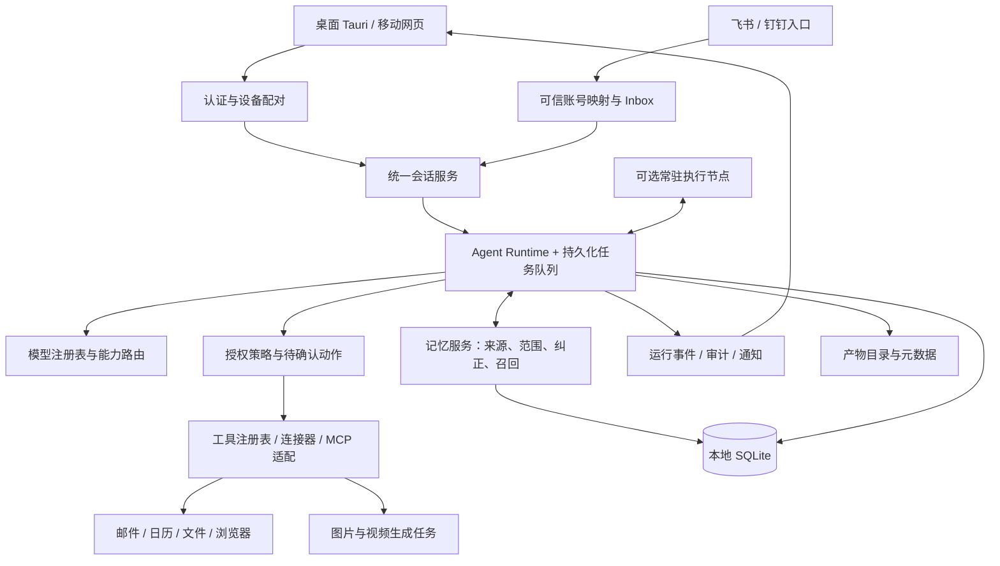

# Soren 架构审查与产品演进方案

审查日期：2026-10-11。范围为仓库中的 Go 后端、React API 契约、Tauri 宿主及现有自动化测试。结论依据实现代码；设计文档、界面按钮和模型生成的描述不作为“能力已经完成”的证据。本轮界面与 macOS 打包改动并行进行，下文的问题描述保留审查时的原始依据，并标注本轮完成的修复。

**本轮交付：** 界面与品牌全新设计、明暗主题持久化、手机响应式抽屉；桌面模型连接已通过 Tauri IPC 打通，凭据写入权限为 0600 的本机配置，保存后重启内置后端；API Key 不写入浏览器存储；聊天改为真实一次性结果展示，修复取消和切换会话竞态。macOS 构建与验证见 `MACOS-BUILD.md`。当前尚未接入 Keychain，真实付费模型和第三方账户仍需用户配置后验收。

**本轮已修复并验证的后端内容：** 默认只监听本机、限制浏览器来源；偏好保留否定词与完整值，兼容旧记录的上下文读取；有消息的会话可正常删除且保留长期记忆；健康接口明确返回模型类型和演示状态。其他架构能力按下方路线实施。

## 结论

**React + Tauri + Go + SQLite 的组合适合 Soren，值得保留。当前产品是“有本地记录和规则记忆的聊天助手原型”，距离可自主执行的个人管家，主要缺少任务运行时、可授权工具、可靠调度及凭据管理。** 单纯换模型、换界面或加入更多提示词，不能补齐这些能力。

建议以“本地优先的个人管家”为定位：对话、记忆和产物默认保存在自己的设备；需要合盖后继续工作时，可以选择连接常驻执行节点。桌面、手机和飞书/钉钉共享同一套任务、权限、记忆和事件协议。

可保留的基础：

- 默认 SQLite，支持 WAL 和串行写入，安装时不用部署数据库；PostgreSQL 是可选服务端路径。见 `backend/internal/store/database.go:20`、`:45`。
- 已将模型、渠道、记忆和仓储分包；渠道和模型有接口，适合逐步替换。
- 对话和记忆确实落库，记忆有标签、多路召回、排序、列表和删除接口；这些不必推倒重写。
- React 的 API 客户端集中，已有类型和错误转换，可以在重构界面时保留业务逻辑。

## 参照产品：借鉴交互方式，明确部署差异

Grok Bot 官方文档描述的是：持久云电脑、连接器和浏览器操作、多 Bot 协作、跨端使用以及可定期运行的技能。工作在笔记本关闭后仍可继续。其账户内的多个 Bot 共享同一台云电脑，同时各自保留角色上下文。[Grok Bot 官方概述](https://docs.x.ai/grok-bot/overview)

Muse 官方介绍说明它运行在专属云端虚拟机，支持跨应用任务、持续工作、长期记忆和敏感动作确认。因此“像 Muse 一样本地记忆”应解释为 Soren 希望实现的产品诉求；**本地存储是 Soren 可以选择的差异化，并非该官方介绍中的 Muse 部署方式。** [Meta：Introducing Muse](https://about.fb.com/news/2026/09/introducing-muse-personal-ai-agent/)

Soren 应学习的核心是：以自然语言交办、长任务可追踪、产物可查看、能力和权限有明确状态、手机可以接续和确认。仅复制聊天外观不会得到这些能力。

## 能力盘点

| 能力 | 当前状态 | 代码依据与边界 |
| --- | --- | --- |
| OpenAI 兼容、Anthropic 文本对话 | 已实现适配，需凭据验证真实服务 | `internal/llm/openai.go`、`anthropic.go`；只发送纯文本消息。没有真实服务的端到端测试 |
| 无 Key 时可启动 | 已实现演示 | `llm/mock.go` 是本地回显，明确提示没有模型。不是本地 AI 推理 |
| 对话持久化 | 已实现 | `models/models.go`、`repository/conversation.go`；无用户归属、分页和消息分支 |
| 本地长期记忆 | 已实现基础版本，已修复丢否定/丢值 | 默认 `~/.soren/soren.db`；正则抽取 + 标签/时间/会话/重要性召回。更复杂的语义抽取、冲突消解和向量检索仍未实现 |
| 本地模型、完全离线推理 | 未内置 | 可配置兼容服务地址，但没有模型下载、运行管理和硬件适配。接入远程模型时，召回的本地记忆会随上下文发往该服务 |
| 飞书/钉钉收消息并回复 | 有真实适配代码，未进行真实账户验证 | 支持长连接和 Webhook；`channel/router.go` 独立调用文本模型。不是完整第三方应用连接器 |
| 桌面模型配置 / 渠道配置 | 模型配置本轮已打通；渠道仍需配置文件 | Tauri `get_desktop_config` / `save_desktop_config` 保存 provider、endpoint、key 并重启内置服务；HTTP 不开放写凭据接口。渠道通过 `~/.soren/.env` 配置 |
| 真正的流式模型响应 | 未实现 | 两个真实 provider 的 `StreamChat` 都返回未实现；HTTP `/api/chat` 一次返回全部内容，本轮已移除原来的前端逐字动画，等待后一次展示真实结果 |
| 自主规划、创建执行 Agent、并行协作 | 未实现 | 没有 Agent、Run、Step、ToolCall 模型和执行循环 |
| 提醒、后台定时任务 | 未实现 | `MemoryTypeTask` 只是文本记忆，没有时间解析、调度、执行状态或通知 |
| 发邮件、读日历、第三方 OAuth | 未实现 | 没有相关工具适配、授权、令牌刷新、发送记录和审批流程 |
| 图片、视频生成 | 未实现 | 没有多模态消息、生成任务、媒体服务适配或产物存储接口 |
| 移动端接续 | 未实现后端支撑 | 响应式页面可改善手机布局；账户、设备配对、安全远程访问、状态同步和推送仍需建设 |

## 必须优先修正的问题

优先级含义：P0 为对外连接/发布前的权限基础；P1 为影响实际可用性、数据正确性的问题；P2 为稳定性、规模和体验问题。

### P0：原始 API 不具备可信访问边界（本轮已收紧本地默认值）

原实现 `cmd/server/main.go` 使用 `r.Run(":" + cfg.ServerPort)` 监听所有网卡，CORS 允许 `*`，路由没有认证。对话模型没有 owner；记忆的 `resolveUserID` 直接信任请求头或查询参数；删除记忆只按 ID 删除，不验证归属（`api/memory.go:123`、`:192`）。会话缓存只含 session ID，缓存命中后的批量取回也不检查 user ID（`memory/recall.go:402`、`memory/store.go:519`）。

这意味着单机原型不能直接通过开放端口变成手机/多人服务；网络可达的调用者可以读取会话、伪装用户或删除他人的记忆。

**方案：** 桌面默认绑定 `127.0.0.1`，限制可信 Origin，Tauri 与 sidecar 建立每次启动的随机令牌或通过受限 IPC 调用。手机访问另走设备配对、TLS 和认证网关。数据库、缓存和任务统一以已验证的 owner/workspace scope 查询；不能把 `X-User-ID` 当认证。删除接口必须同一条查询校验 owner。

**本轮状态：** 已新增 `SERVER_HOST=127.0.0.1` 默认值，以 `net.JoinHostPort` 组装监听地址。CORS 仅允许 `http://localhost:1420`、`http://127.0.0.1:1420`、`tauri://localhost`、`http://tauri.localhost` 和 `https://tauri.localhost`；未经允许的浏览器来源返回 403。随机令牌、账户认证和用户归属校验仍是后续工作，loopback/CORS 不等于完整身份认证。

### P1：模型设置和实际调用脱节（桌面配置本轮已打通）

`api/chat.go:140` 默认模型为 `gpt-3.5-turbo`，而 `main.go` 启动时优先选择 Anthropic；`defaultModel` 在两个 Key 同时存在时却返回 OpenAI 模型名。前端只传 `model/temperature/max_tokens`，provider、Key 和 base URL 没有后端写入接口（`frontend/src/services/api.ts:155`）。因此保存界面表单不等于完成模型配置，甚至可能把 OpenAI 模型名发给 Anthropic。

原始设置存储的 `readPersisted` 返回 null、`persist` 为空，重启丢设置。即使前端补齐持久化，也仍需要后端配置链路。

**方案：** 增加 Provider Registry 与 `GET/PUT /api/settings/providers`、连接测试接口；由后端返回当前 provider、有效模型和能力。Key 保存到 macOS Keychain，数据库只保存凭据引用，接口只返回 masked/configured 状态。前端主题等非敏感偏好可本地持久化，Key 不进入普通浏览器存储。默认模型与 provider 在一个配置源中决定。新增 provider 时应声明是否支持工具、图片、视频、流式及最大上下文。

**本轮状态：** 桌面设置已通过受限 Tauri IPC 完成保存与重启，浏览器预览明确禁用凭据保存；非敏感设置已持久化；切换 Anthropic/OpenAI 时同步对应默认模型。保存成功仅代表本地配置和服务就绪，不是远端 Key 有效性验证。仍建议后续使用统一模型注册表、Keychain、能力探测与真实连接测试。

还应删除 `store/database.go:23` 对完整 PostgreSQL URL 的日志输出，避免部署时把 URL 中的数据库凭据写入日志。

### P1：记忆会丢失偏好值、否定含义和更新关系（本轮已修复前两项）

审查时确认了两个问题：

1. `memory/extractor.go:18` 将“不要/别/不喜欢”放在非捕获组，`:60` 只保存后面的捕获内容。例如“不要用英文回答”得到“用英文回答”，否定含义消失。
2. `memory/manager.go:219` 写入完整 `Content`，但 `Summary` 只有 `preferenceKey`；`:461` 注入模型时优先使用 Summary。例如“喜欢用中文回答”最后可能只注入“语言偏好”。现有测试仅检查主题词存在，未检查值是否保留（`api/chat_test.go:154`）。

同一偏好的新值虽然会覆盖 `user_preferences` 表，但每次仍新增独立 Memory，召回不读这张偏好表，不保证旧偏好不再进入上下文。`GenerateSummary` 实际是截断；它不会判断一次性请求、稳定偏好、引用文本或假设。归档/过期清理有方法但没有调度入口；召回 SQL 也未统一排除过期项。

**方案：** 先保留完整陈述和否定词，偏好记忆注入 `主题: 值`；再升级为可校验的结构化抽取：来源消息、scope、类型、值、置信度、确认状态、生效时间、替代关系。用户明确纠正的值取代旧值；助手推测不能自动变成个人事实。先做全文检索 + 明确偏好表，再按实际召回质量增加向量检索。允许查看、纠正、关闭自动记忆、导出和彻底删除；“从召回中移除”和“物理清除”需区分。

**本轮状态：** 抽取改为保留完整匹配陈述；新偏好的 Summary 写入主题和值；`BuildContextBlock` 对偏好优先读取完整 Content，使旧的“仅主题摘要”记录仍能注入已有的值。新增否定语义、落库后召回及旧记录兼容测试，并把聊天测试从检查“咖啡”加强为检查“喜欢拿铁咖啡”。已经在历史记录中丢失的否定词不能可靠猜回，需由用户纠正；冲突消解与自动提取质量尚未整体重构。

### P1：包含消息的会话无法删除（本轮已修复）

原 `ConversationRepository.Delete` 直接删除父表，SQLite 已开启外键且关联没有级联删除，真实 API 探测得到 HTTP 500。现在使用同一事务先删除该会话的消息，再删除会话；独立长期记忆继续保留。新增仓储测试同时验证目标消息清除、其他会话不受影响及长期记忆保留。

### P1：渠道、桌面走了两套对话流程

`api/chat.go` 会召回和提取记忆；`channel/router.go:145` 只保存消息、读取最近 20 条、调用 provider、发回平台，完全不依赖 MemoryManager。渠道中的 `SenderID` 没有映射为可信个人身份。用户在飞书交代的偏好不会按桌面路径写入记忆；群聊也不能直接合并进个人私有记忆。

**方案：** 抽出统一 `ConversationService / AgentRuntime`。桌面、手机、飞书/钉钉只是不同入口，输入统一成 `Principal + Conversation + Message + CapabilityScope`。连接账号需显式绑定个人身份；群聊、私聊、个人记忆使用独立 scope。共享记忆由权限和来源决定，不能仅凭昵称或群 ID 合并。

### P1：消息处理和重试没有可靠性协议

- `channel/router.go:117` 每条消息起 goroutine；同一会话没有排队，容易读到交错历史、回复乱序。
- `Conversation.ExternalKey` 只有普通索引（`models/models.go:30`），`GetOrCreateConversation` 的并发回查无法阻止两个并发请求都插入成功。
- 渠道收到的 `MessageID` 未用于持久去重，队列满则丢弃，但回调仍可能已经成功确认（`feishu.go:294`、`dingtalk.go:347`）。
- 聊天先写用户消息再请求模型，失败后没有请求 ID 和重试语义。重新发送/重新生成继续走同一个 POST，会再追加用户消息；UI 中替换回复不等于数据库中替换或分支。

**方案：** 建立持久化 inbox/outbox，以 `(provider, account, message_id)` 唯一去重；同一 conversation 串行、不同 conversation 有界并发。发送和工具调用使用幂等键及重试状态。任务和消息采用独立 ID，重新生成按 parent message 创建版本/分支。外部会话键建立合适的唯一约束（本地无外部键使用 NULL 或部分唯一索引），不能对当前空字符串直接加全局唯一约束。

### P1：Webhook 的信任与回执地址校验不足

钉钉 Webhook 在 `WebhookSecret` 为空时跳过验签（`dingtalk.go:260`），但该模式的启动校验不要求 secret；回执地址只检查 `https`（`:447`），并非验证平台域名。这样在 Webhook 服务对外可达且未配 secret 时，任意回调可伪造输入和回复地址。飞书的自定义签名校验没有时间窗/nonce 重放控制；应用层亦没有事件去重。

**方案：** webhook 模式配置不完整应拒绝启动；所有请求必须验证来源、时间窗和事件唯一性。回执 URL 做受限平台域名验证，并限制重定向目标；外部工具连接使用集中 egress 策略。SDK 长连接适配保留为桌面优先路径，避免要求普通用户部署公开回调服务器。

### P2：聊天与运行状态还不足以支撑长任务

`repository/conversation.go:31` 无排序地预加载全部消息，桌面对话没有上下文预算；`AddMessage` 不更新 conversation 的 `updated_at`，列表按旧时间排序。两个真实 provider 的 HTTP client 没有超时；任务只有单次 HTTP 请求生命周期。渠道管理器保存启动快照，连接随后失败只写日志，API 仍可能报告 running。

**方案：** 显式消息序号/排序、分页历史、token 预算与上下文压缩；消息写入与对话更新时间事务化。provider 配置超时、取消、限流、有限重试，保留结构化错误。健康状态区分进程可达、数据库、模型配置、渠道实时连接和 worker。所有长任务从数据库 Run 状态与事件流恢复，不能依靠某个页面仍在打开。

**本轮状态：** `/api/health` 已增加 `llmProvider`（`anthropic`、`openai-compatible` 或 `local-echo`）及 `demoMode`；它们仅描述当前选择，既不暴露凭据/端点，也不冒充远程模型连通测试。

## 建议的目标架构

保持单仓库和模块化单体，现阶段不必拆微服务。优先拆清责任，再按部署需要拆进程。

### 任务和 Agent

建立 `agents`、`runs`、`run_steps`、`tool_calls`、`approvals`、`artifacts`、`schedules`、`connections`、`audit_events`。Agent 表示角色、可用工具和记忆范围；Run 才是一次实际任务，二者不可混为一个聊天。

Run 至少具备 `queued → running → waiting_approval / waiting_input → succeeded / failed / cancelled`，每一步先落库再产生副作用。中断恢复时通过幂等键或外部服务回执判断某封邮件/某个视频是否已经提交，不应重启后盲目重复。支持超时、取消、重试、token/费用上限及有限子任务深度；子 Agent 权限不得超过创建者已授予的范围。

首版先做一个主 Agent + 有界子任务，完成可靠闭环后再扩展多人格、多 Bot。不要把无限制 shell 或“让模型自己想办法”当作工具系统。

### 连接器与邮件

把“消息渠道”和“执行工具”分开：飞书输入是 channel，查询日历、读取文件、创建邮件草稿是 tool。工具统一声明 JSON Schema、授权范围、风险级别、幂等规则、超时和产物类型。可提供 MCP 适配，但 MCP 本身不能替代身份、授权和任务恢复。

优先做一个邮件连接器及一个日历连接器。OAuth 令牌只由凭据服务取用，模型仅看到连接名称、可用能力与必要结果。发邮件闭环为“生成草稿 → 展示收件人/主题/正文/附件 → 用户授权发送 → 保存服务端 message ID”；后续可支持用户配置明确的长期发送规则。外部邮件/网页中的文字属于待处理数据，不能自行扩大权限或指定额外收件人。

### 图片与视频

引入统一 Artifact：文件路径/对象引用、MIME、尺寸、时长、缩略图、来源任务、模型、生成状态、错误与费用。图片可同步或短任务完成；视频应按异步任务提交、轮询/回调、取消、失败重试和下载管理设计。生成结果先入产物库，再显示在聊天或工作室。

工具与模型分开建模，文本模型不自动具备图片/视频生成能力。按当前配置动态启用入口，未接入时展示“待连接”，不能用文字回复假装已经生成文件。

### 本地记忆与跨设备

默认设备保存原始会话和记忆；若调用远程模型，要准确说明相关上下文会被发送给该服务。桌面文件和凭据通过受限桥接访问；“本地优先”不等于任何网页都能访问整个磁盘。

移动端第一步做响应式界面和安全配对后的远程控制：看任务、看产物、确认动作、发送新请求。手机通常不承担长时间模型/浏览器执行。若用户希望电脑合盖后继续工作，必须有可选的常驻 Mac、家庭主机或云 worker。可默认只同步运行状态与用户选择的任务材料，记忆跨设备同步单独授权；冲突用版本和 tombstone 处理。

### 界面信息架构

- **对话**：输入和结果是主角，展示调用工具、当前步骤、需要确认的动作与成果；避免把所有后台配置塞到首页。
- **任务**：真实状态、计划、进度、暂停/取消、历史执行记录；未完成 runtime 前不展示虚构的成功任务。
- **记忆**：能够搜索、纠正、忘记并查看来源；不把任务笔记当成已经设置的提醒。
- **连接**：明确区分“未连接、已连接、权限过期、连接异常”；支持断开授权。
- **产物**：图片、视频、文档可预览、下载和追溯到任务。
- **设置**：模型、隐私、设备、外观；亮/暗主题统一语义色，渐变集中于品牌图形和少量强调区。

桌面可用侧栏 + 主工作区 + 可收起的任务详情；手机采用单列、底部导航和抽屉。桌面包应包含后端和资源，首次打开明确展示模型连接状态。前端视觉重构和后端能力演进需要同时保留诚实的空状态。

## 分阶段落地与验收

| 阶段 | 工作 | 完成标准 |
| --- | --- | --- |
| A：可靠桌面基础 | UI 重构、亮暗主题、响应式、新图标、内置后端的 macOS 包；模型配置闭环；本地 API 边界；记忆语义与会话删除问题 | 干净用户目录安装启动；设置重启保留；填写 Key 后真实对话；旧消息稳定排序；偏好保留否定与值；可删除自己的会话和记忆 |
| B：个人管家最小闭环 | Run/Step/Event、持久队列、一个邮件与一个日历工具、明确审批、产物库 | “整理日程并拟邮件”能产生真实草稿；用户确认后只发送一次；重启可恢复；工具失败能解释并重试 |
| C：创作与自动执行 | 图片生成、异步视频生成、定时规则、通知、有限子 Agent、渠道统一 runtime | 真实图片/视频可下载；定时执行有历史；取消停止后续动作；飞书和桌面遵守相同记忆/权限范围 |
| D：手机和常驻服务 | 设备配对、安全网关、移动推送、可选常驻 worker、同步及冲突处理 | 电脑合盖时由授权节点继续执行；手机收到需要处理的通知；撤销设备后即失去访问；跨端删除不会被旧副本恢复 |

阶段 A 的界面和包装可以本轮完成，但 B–D 必须逐项实现和真实服务验收，不能通过菜单或 mock 宣称具备。

## 验证记录与缺口

已有测试集中在 cache、memory 和部分 chat/memory API；测试中的模型为 stub，渠道、真实 LLM、配置写入、鉴权、任务恢复、媒体生成目前无相应端到端覆盖。

- 首次执行 `go test ./...`，由于本机 `GOPROXY=direct` 导致 `golang.org` 等依赖下载超时，测试未完整启动。用命令级 `GOPROXY=https://goproxy.cn,direct` 重试后，原有测试全通过；未修改全局 Go 配置。
- 完成本轮修复后，再次执行全套 `go test ./...` 通过，包括新增的默认 loopback、受信/恶意 Origin、偏好否定、完整值召回、旧记忆兼容和事务删除测试。
- 临时独立数据目录启动真实 Go 服务，未使用用户数据库、模型 Key 或第三方账号。验证：未配置模型返回 `llmProvider=local-echo`、`demoMode=true`；可信 Origin 返回 200，未知 Origin 返回 403；否定偏好内容正确落库；删除已有消息的会话返回 200，后续读取为 404，长期记忆条数不变。探测服务退出后已清理临时数据。

下一批有价值的回归测试应验证行为：否定偏好保留、偏好值进入 prompt、跨用户禁止读删、同一会话并发顺序、重复平台事件只处理一次、模型失败重试不重复写消息、邮件重启后不重复发送。截图与单元测试通过不能替代真实账号连接测试。
