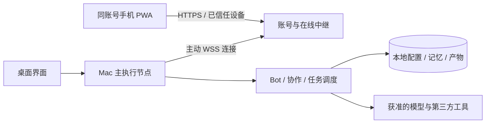

# 多 Bot、记忆协作与跨端账号方案

更新：手机入口改为原生安装包与扫码配对，允许通过 Mac 批准加入同账号空间，无需两端重复登录。以 [最新扫码关联方案](MOBILE-PAIRING-RESEARCH.md) 为准；后文保留早期完整路线。

状态：路线设计，用户已授权开始开发。0.2 已实现本地多 Bot、独立记忆、共享资料与有限文本协作，详见 [本地交付与边界](MULTIBOT-DELIVERY.md)。用户暂无服务器，账号/配对/手机中继保留为待部署与待实现部分。下文描述完整目标，不代表全部已上线。

## 1. 产品决策

1. 一个账号默认拥有一个个人工作空间，空间中可以创建多个长期 Bot。
2. 默认 Soren 是总管，可协调用户授权的其他 Bot；每个 Bot 也能被用户直接对话和交办任务。
3. Bot 拥有自己的职责、配置、历史和长期记忆。不同 Bot 的私有记忆默认互不可读。
4. Bot 可以交流，通过有参与者、目标、权限、预算和结束条件的协作任务交流；不默认在后台无限互聊。
5. 用户定义职责，AI 可生成职责草稿；Bot 可在职责范围内自行拆任务，不能自行扩大长期职责、应用权限或记忆可见范围。
6. 手机与 Mac 使用同一个账号、进入同一个工作空间。首次接入还需一次性设备信任确认。扫码用于建立设备信任，不替代账号身份。
7. 第一版每个工作空间由一台指定 Mac 作为主执行节点和业务数据源；手机是完整操作客户端。Mac 离线时，手机可看已缓存内容、写草稿，不能执行任务。
8. 邮件、图片、视频等实际能力来自工具适配与供应商配置，不会因为创建 Bot 或写职责就自动获得。

## 2. 实体关系与现有架构

```text
账号（Account）
└─ 个人工作空间（Workspace；第一版单人）
   ├─ 已信任设备：Mac / 手机 / 其他客户端
   ├─ 主执行节点：指定的一台 Mac
   ├─ Bot：Soren 总管 / 工作助手 / 创作助手 / 自定义 Bot
   │  ├─ 职责与能力配置（有版本）
   │  ├─ 独立会话、任务、私有长期记忆
   │  └─ 应用和共享记忆授权
   ├─ 用户明确共享的个人资料与项目资料
   └─ 协作任务：多个 Bot 的步骤、交流记录与产物
```

账号是身份，工作空间是数据和权限边界，设备是入口，执行节点是运行任务的机器，Bot 是持久角色配置。不能把设备、对话或每次模型请求当作 Bot。

保留 React + Tauri + Go + SQLite。多个 Bot 共享 Go 执行服务，不为每个 Bot 复制一套后端或启动一个完整应用；调度器分别加载各自配置和上下文。SQLite 的逻辑隔离由所有查询、缓存、向量索引、附件访问和工具授权共同执行，不仅靠提示词要求模型“不要访问”。

当前缺口：Bot 实体、任务运行时、工具授权、独立记忆作用域、统一渠道入口、账号认证、设备信任与同步协议。代码审查详见 [架构审查](ARCHITECTURE-REVIEW.md)。

## 3. 创建、定义和管理 Bot

### 3.1 用户界面

桌面侧栏顶部显示当前 Bot，点击展开“全部 Bot / 新建 Bot”；手机使用同一切换器和 Bot 列表。创建页先展示名称、头像、职责，应用权限和记忆设置使用可展开区域，避免堆满说明。

支持两条创建路径：

- **手动创建**：填写职责，选模型、应用和记忆范围，保存后进入对话。
- **让 Soren 创建**：用户说“帮我建一个短视频助手”，Soren 生成可编辑配置预览，用户保存后才成为长期 Bot。

Bot 详情使用四个页签：**对话、任务、记忆、配置**。没有内容时只给一个简短空状态和操作入口。

### 3.2 职责不是一段无约束提示词

| 配置 | 内容 | 默认行为 |
| --- | --- | --- |
| 身份 | 名称、头像、描述 | 用户可编辑 |
| 目标与职责 | 做什么、处理哪些输入、交付什么 | AI 可辅助起草 |
| 工作方式 | 语气、格式、流程、何时询问用户 | 作为有版本的角色说明 |
| 模型 | 服务商、模型、参数 | 继承空间默认，允许覆盖 |
| 工具 | 可使用哪些已连接应用及动作 | 默认不开放写操作，按动作授权 |
| 记忆 | 私有记忆开关、共享资料访问范围 | 私有启用，共享项明确选择 |
| 协作 | 允许联系的 Bot、可接受的请求类型 | 默认关闭，用户启用后限定参与者 |
| 自主程度 | 每步确认 / 授权范围内执行 / 已启用的定时工作流 | 默认授权范围内处理普通任务；外部写入单次确认 |
| 限额 | 并发、任务时限、调用和委派预算 | 有限默认值，达到上限暂停 |

示例“工作助手”：整理日程、总结工作资料、起草邮件；可读选定日历、创建草稿；发送邮件须用户批准；只读“工作项目资料”，不读其他 Bot 私有记忆。

示例“创作助手”：选题、分镜、配图和视频生成；可用已配置的媒体生成工具；只读“品牌与创作偏好”；不能读取邮箱。涉及付费生成时展示预计开销或调用额度，按用户预设预算执行。

### 3.3 Bot 是否可以定义自己的职责

可以提出建议，不能静默改写持久配置。例如“我经常帮你整理会议，建议增加会议纪要职责”，用户在配置差异预览中保存后生效。

一次任务中，Bot 可以自行确定步骤和临时分工，不需要每一步都让用户重建角色。但新增应用权限、长期职责、共享记忆范围和定时任务必须由用户明确启用。角色说明不能覆盖系统工具授权策略。

修改职责生成新版本：新任务使用新版本；已运行任务保留启动时的职责快照。权限撤销立即影响正在运行任务的后续动作，不等待任务完成。降低预算也立即约束后续调用。

### 3.4 生命周期

支持新建、编辑、复制配置、暂停、归档和删除。复制默认只复制配置，不复制历史、私有记忆和授权凭据；应用授权需重新确认。暂停停止接收新任务，用户选择是否取消正在执行的任务；归档保留数据并从常用列表隐藏。

删除前展示影响：该 Bot 的私有记录按用户选择删除；其他 Bot 和共享个人资料不受影响。已发布到协作任务的产物仍属于该任务，删除 Bot 不自动撤回其他参与者已获得的副本。用户可单独清理对应任务记录。

## 4. 独立记忆与可控共享

### 4.1 四个层次

| 层次 | 保存什么 | 谁能读 | 生命周期 |
| --- | --- | --- | --- |
| 会话上下文 | 当前聊天消息与摘要 | 当前 Bot、获准的客户端 | 对话管理规则 |
| Bot 私有长期记忆 | 专属偏好、职责经验、用户明确交代的事实 | 该 Bot | 可查看、修改、删除、关闭自动记忆 |
| 共享长期资料 | 用户选定的称呼、语言、品牌规范或项目知识 | 被逐一授权的 Bot | 用户管理，记录来源和版本 |
| 协作任务上下文 | 本次目标、必要输入、阶段结论、引用和作品 | 任务指定参与者，按分步范围授权 | 任务结束只读归档，不自动升为长期记忆 |

**独立记忆不等于完全不能共享。** 默认隔离；需要共享时通过明确的资料授权或一次任务中的最小必要内容传递。

总管 Soren 也没有读取全部 Bot 私有历史的特权。它只能看到获准的资料和任务汇报。共享个人资料与项目资料是不同集合，可以把语言偏好开放给全部选定 Bot，把工作资料只开放给工作相关 Bot。

### 4.2 记忆写入与交流的关系

- 用户直接在某个 Bot 的私人会话中说“以后都按这种结构写”，可按该 Bot 的记忆策略保存，界面提供可撤销的保存结果。
- 其他 Bot 的消息是带来源的任务材料，不能作为修改系统配置或扩大权限的指令。
- Bot 间交流、网页和外部文档中的内容，不自动写成个人事实或共享长期记忆；来源、证据和置信状态需保留。
- Bot 可以提出“建议保存为项目资料”，由用户确认写入共享集合。允许在已授权的专属工作流中更新指定资料，但记录版本与修改者。
- 冲突事实不能直接合并；保留来源并请求确认。明确更正后旧值退出召回。会话、全文/向量索引、缓存和删除事件采用一致的可见性检查。
- 用户可在“记忆”页选择“当前 Bot / 共享资料”，查看来源、可访问的 Bot、编辑或删除。
- 撤销共享后禁止新的读取并失效缓存；不能保证抹除已被其他 Bot 写进旧任务产物的内容。界面提供关联任务定位和单独清理入口。

### 4.3 一个具体例子

你告诉“工作助手”客户报价底线：只进入其私有记忆。你把品牌配色保存到“品牌资料”并授权工作助手和创作助手：两者都可以读取。创作助手替工作助手配图时，只收到本次文案、画面要求和获准品牌资料，不会顺带获得报价底线或整个邮箱。

## 5. 多 Bot 如何交流与协作

### 5.1 三种用户入口

1. **直接协作**：对某 Bot 说“让创作助手给这份方案做配图”，前提是两个 Bot 已加入允许协作范围。
2. **总管调度**：交给 Soren 一个目标，由其选择职责匹配、当前可用且获准参与的 Bot，展示任务分工。
3. **固定协作工作流**：用户保存“每周内容计划”等模板，规定参与者、步骤和审批点。只有明确启用后才能定时主动执行。

第一版使用一个“协作任务”页面承载，不先做无限聊天式 Bot 群。默认用户只看到进度、阶段结论、作品和待批准事项；展开“协作记录”可看谁交办了什么、采用了哪些资料及结果。展示可核验的执行记录，不输出模型的隐藏思维链。

### 5.2 消息与执行协议

交流由后端消息队列/调度器转发，不让 Bot 彼此直接持有数据库连接或对方凭据。消息类型包括交办、澄清、回复、结果提交、失败、取消。

每条消息至少包含：空间、任务、消息 ID、发送者、接收者、上游请求、目标/问题、授权的输入引用、预期产物、截止时间、可见范围和去重键。较大附件用带权限的引用，不把所有历史塞进提示词。

调度过程：

1. 校验用户授权和参与者名单，确定任务执行图、预算、截止条件。
2. 分配步骤时，以该 Bot 职责快照和获准资料构建上下文；只接收需要的历史摘要。
3. 执行工具前再次校验授权：用户的任务授权 ∩ 当前 Bot 的工具授权 ∩ 该步骤范围。
4. 子 Agent 只能继承更窄的父任务范围；调用另一个长期 Bot 也不能扩大整个任务授权。需要额外能力时暂停该步骤并向用户申请。
5. 返回结果附产物、引用和状态；结果只能在授权任务范围内共享。
6. 总管整合结果，关键外部动作进入单次批准；失败或取消沿依赖关系传播，保留已完成产物。

默认建议：每任务最多 3 个并行 Bot、最多 2 层委派、最多 12 次跨 Bot 消息、20 分钟运行上限；这些是首版可配置起点，需用实际任务评估，不是能力保证。付费调用另设硬预算。达到上限后暂停并给用户继续/调整选项，不自动续费或重开任务绕过限制。

识别重复委派与依赖环，使用消息去重和任务锁。遇到职责不匹配、工具不可用或协作被关闭时明确返回原因；不能假装另一个 Bot 已完成工作。

### 5.3 协作示例：制作并发送活动方案

| 步骤 | 负责 Bot | 可访问内容 | 产出/审批 |
| --- | --- | --- | --- |
| 1. 拆解目标 | Soren | 用户本次要求、授权的活动资料 | 分工与预算 |
| 2. 准备方案 | 工作助手 | 活动资料和本次任务上下文 | 文案、配图需求 |
| 3. 生成配图 | 创作助手 | 配图需求、授权品牌资料 | 图片与生成记录 |
| 4. 组装邮件 | 工作助手 | 文案、图片、用户指定收件人 | 可审阅的邮件草稿 |
| 5. 发送 | 邮件工具 | 单次批准所绑定的确切参数 | 用户确认后发送一次并记录回执 |

创作助手不需要邮箱权限；Soren 不需要读取工作助手的全部记忆。用户取消任务后不启动后续动作，已发出的邮件等不可逆操作不能被“取消”撤销，需要显示实际结果。

### 5.4 长期 Bot 与临时子 Agent

长期 Bot 是用户空间中的持久角色。临时子 Agent 是一次任务中的临时角色，默认没有独立长期记忆，只读取任务分配的内容；结束后归档执行记录，不自动加入 Bot 列表。用户可把其角色草稿保存为长期 Bot，仍需配置权限和记忆范围。

## 6. 同账号与设备信任

**手机、Mac 必须以同一个账号进入同一个工作空间，才能联动。** “登录同账号”确定归属，“信任这个设备”确定是否允许它访问本地执行端；两者各有作用。

第一版提供邮箱验证码登录，后续可增加 Passkey/Apple 等方式。认证模块使用成熟实现或托管身份服务，提供统一接口；具体服务商、域名与部署成本在上线配置时确定，不自行发明密码协议。不在此文档中假定已经接通某个认证产品。

### 6.1 初次设置

1. Mac 可先离线使用，创建本地空间和默认 Soren，无需账号。
2. 用户点击“开启手机联动”，登录或注册账号；将当前本地空间绑定到该账号，显示所绑定的账号和数据范围。
3. 绑定前备份并保留现有 ID，通过事务加入账号/空间归属；不自动上传整个聊天库。已绑定其他账号的空间不能自动合并或改绑。
4. Mac 注册为该空间的主执行节点，云端只登记空间、设备、节点状态等控制信息。
5. 手机打开 Soren PWA，登录同账号后看到可连接的空间；此时尚不能读取该空间的聊天。
6. 用户在 Mac 显示 5 分钟有效的一次性配对二维码；手机扫码发起请求，Mac 展示账号、设备和确认码，用户确认后把手机加入受信任设备。
7. 之后手机正常登录即可连接，不需每次扫码。清除浏览器数据、换手机或设备被撤销后，需要重新信任。二维码截图和同账号登录本身都不足以跳过最终设备确认。

不同账号扫码直接拒绝，不把“知道二维码”当成加入他人空间的资格。团队共享、多账号共用 Bot 和家庭成员权限均不进入首版范围。

### 6.2 同账号不代表数据自动存云端

| 位置 | 第一版保存什么 | 不保存什么 |
| --- | --- | --- |
| 账号与中继服务 | 账号标识、登录/设备会话、空间与设备登记、撤销状态、短期连接元数据 | 不长期存储完整聊天、Bot 私有记忆、作品或模型 Key |
| Mac 主节点 | Bot 配置、聊天、记忆、任务、产物、授权配置 | 不与任意同账号设备自动共享全部数据 |
| 手机 | 登录状态、设备信任信息、用户打开的记录缓存、待发送草稿 | 不存模型 API Key 或第三方应用长期令牌 |

中继处理在线转发，不记录业务正文到应用日志。TLS 保护传输，但第一版服务端仍可能处理明文业务消息，不能宣称端到端加密。若要求中继也不能读取内容，需要额外实现并验证端到端密钥协议、附件加密和恢复机制。

手机版账号登录凭据优先使用安全 HttpOnly Cookie 与相应的 CSRF 防护，不存长期登录令牌到 localStorage；设备信任会话独立可撤销。桌面凭据存系统凭据库。具体浏览器设备密钥储存方案需在实现时验证，不把浏览器非导出密钥等同于硬件安全存储。

### 6.3 多设备与恢复

- 一个空间首版只有一个主执行节点，避免两台 Mac 重复执行邮件或定时任务。另一台 Mac 作为客户端接入，或走明确的迁移流程接替主节点。
- 后续主节点迁移需备份/恢复、停旧节点、切换执行租约与版本号；接管时不能让旧节点继续对外执行。
- 手机丢失：在 Mac 或账号设备页撤销，断开连接并使会话失效。已下载到手机的文件不能保证远程抹除。
- 退出手机账号：撤销当前会话，清理本地业务缓存和草稿前给予用户保留/导出的选择；不能残留可访问旧空间的会话。
- 账号找回恢复账号访问，不等于恢复 Mac 的本地数据库。Mac 丢失且无备份时，不能从中继找回不存在的记忆；旧主节点应先撤销，新节点需从用户备份恢复并重新配对。
- 本地模式不受账号服务临时不可用影响；远程新建会话在身份无法验证时拒绝。已有远程会话使用短期有效期和撤销检查，过期后断开，不无限续用旧授权。

## 7. 手机与桌面的实际运行规则



Mac 主动连接中继，不对公网开放现有无认证的 8080 API；所有远程命令经验证后才进入内部服务。中继、移动站点和账号系统需要真实部署与运维。

| 场景 | 明确行为 |
| --- | --- |
| Mac 在线、手机在线 | 同一 Bot 列表与业务状态；手机可创建/配置 Bot、对话、管理记忆、发任务、取消、批准和查看结果 |
| 手机断网或关闭 | Mac 已接收的任务继续；手机重连按事件游标补齐结果 |
| Mac 关闭、休眠或服务退出 | 新任务不可执行；手机只看标记为离线缓存的内容并写草稿，不显示已接单 |
| 手机发送时未收到回执 | 按原请求 ID 查询结果；不能直接创建另一份相同任务 |
| 两端同时修改 Bot | 版本冲突提示，用户决定采用哪版；不静默覆盖 |
| 两端打开同一对话 | 第一版该会话只运行一个活动任务；新消息进入明确的待发送队列，用户可选择取消当前任务后发送 |
| 不同 Bot 同时工作 | 在统一并发/预算限制内独立执行，不串上下文 |
| 需要全天候执行 | 后续增加常驻主机或云执行端，另行确认数据、权限与费用 |

每条写命令有请求 ID，每个事件有递增序号。同步的是一个主节点的权威状态，第一版不做手机与 Mac 两套数据库的任意双向合并。手机只有主节点确认后才显示“已保存/已执行”。图片、视频以授权的分块下载/上传和产物引用传输，不能把二进制塞进普通消息事件。

工具批准绑定空间、任务、Bot、工具、确切参数、有效期和一次性标记；参数变更重新批准。发送邮件等外部写入执行前持久化意图，采用供应商幂等能力或去重记录；遇到结果不确定时核对回执/转人工处理，不承诺跨外部系统天然 exactly-once。

## 8. 数据与代码落点

| 模块 | 最小新增内容 |
| --- | --- |
| 身份与空间 | accounts / workspaces / devices / execution_nodes / device_sessions；控制面认证与本地空间归属 |
| Bot 配置 | bots / bot_versions / bot_tool_grants / bot_collaboration_grants |
| 记忆 | memories 增加 workspace_id、bot_id、scope、collection_id、来源、版本与失效标记；memory_collections 与访问授权 |
| 任务协作 | runs / run_participants / run_steps / agent_messages / tool_calls / approvals / artifacts |
| 同步与可靠性 | sync_events / request_dedup / 节点租约、事件保留与删除标记 |
| 原有数据 | conversations / messages / 附件增加明确空间与 Bot 归属；历史数据迁移到默认 Soren |

SQLite 保留业务数据；账号服务的账户凭据不复制到本地业务库。账号控制面与本地用户归属字段有不同用途，避免把上表理解为所有账户信息都落在一个 SQLite 文件。

所有入口统一：身份解析 → 空间/Bot/权限 → 记忆上下文 → 任务运行时 → 工具适配 → 持久化事件 → 客户端订阅。飞书/钉钉需绑定可信平台用户，复用同一服务；群聊不自动读入个人私有记忆。

先建立 BotRegistry、MemoryService、PolicyService、RunService、ToolRegistry、SyncService 的接口与数据库迁移。工具通过后端策略验证；所有 LLM 的工具建议都只是执行请求，不能直接绕过策略执行。

任务最小状态：queued / running / awaiting_approval / paused / succeeded / failed / cancelled。进程重启只恢复可安全重试的步骤；职责配置使用快照、权限校验使用当前授权，恢复时重新核对。

## 9. 开发顺序与可验收结果

### A. 桌面多 Bot 与独立记忆

创建/编辑/复制/暂停/归档 Bot，职责版本化，独立聊天和记忆，共享资料可授权，现有记录备份迁移。验收：两个 Bot 不串数据；总管不能默认读私有记忆；用户更正记忆后旧值不被召回；配置复制不带走历史和权限。

### B. Bot 协作与任务运行时

任务状态、参与者授权、子任务与消息协议、工具策略、预算、取消/恢复、协作记录和单次批准。验收：两个 Bot 能完成有依赖的协作任务；不能通过委派越权；重复消息不重复执行；协作内容不自动写入共享长期记忆；循环和预算上限生效。

### C. 同账号跨设备

账号服务、空间绑定、设备信任、PWA、中继、增量同步、设备撤销、缓存与离线提示。验收：同账号受信任手机操作同一批 Bot；同账号未信任设备/不同账号均不能读数据；断网重连无重复提交；撤销立即阻断后续访问；Mac 休眠时不伪装在线执行。

### D. 第三方行动与主动管家

先接一种邮件、一种日历，再接图片/视频和用户启用的定时工作流；统一渠道入口。任务和工具接口在 B 阶段形成，D 接入真实供应商。验收：手机确认具体邮件，Mac 发出一次并返回真实回执；媒体展示真实作业 ID、失败原因和可下载产物；各 Bot 只能使用获准服务。

## 路线与当前进度

推荐采用：**同账号、同空间、一次性设备信任；多 Bot 独立记忆，按授权共享资料与任务信息；用户定义职责，Bot 可提案、拆解和协作但不能自行扩大权限；本地 Mac 主执行，第一版手机 PWA。**

按 A → B → C → D 推进。A/B 的本地基础已交付，剩余能力以交付文档为准；C 暂做部署准备，D 尚未接入。
